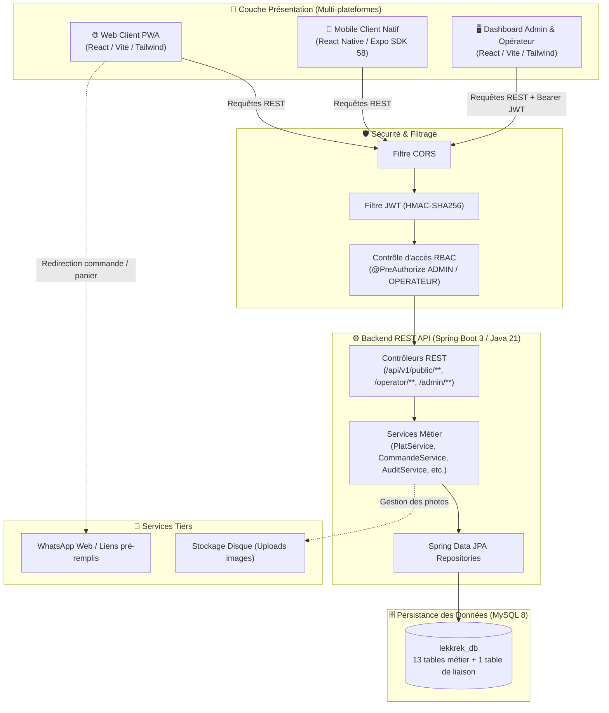
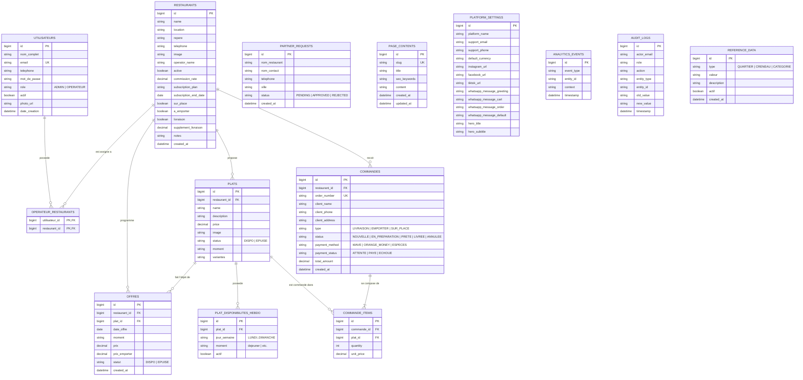

# LekkRek — Plateforme de Gestion de Restaurants & CMS

**LekkRek** est une solution métier de bout en bout destinée à la gestion de restaurants, des commandes en temps réel et à la publication de contenu dynamique (CMS). Elle couvre l'espace vitrine client, le dashboard opérateur et le panneau d'administration.

---

## Architecture

Le projet suit une architecture découplée Frontend / Backend :

| Couche | Technologie | Rôle |
|---|---|---|
| **Frontend** | React.js (Vite) + Tailwind CSS | Vitrine client, dashboard admin & opérateur |
| **Mobile** | React Native (Expo SDK 58) + TypeScript | App mobile native client (menus, filtres, panier) |
| **Backend** | Java 21 + Spring Boot 3 + Spring Security | API REST, sécurité JWT, logique métier, KPI |
| **Base de données** | MySQL + Hibernate/JPA | Persistance des données (13 entités + 1 table de liaison) |
| **CI/CD** | GitHub Actions | Validation backend (Maven), frontend (Vite) et mobile (Expo) sur chaque PR |

### Diagramme d'Architecture Globale (UML)



### Architecture des Données (Diagramme Entité-Relation UML)



---

## Fonctionnalités

### Espace Client (public, sans inscription)
- Consultation du menu du jour par restaurant
- Filtres par restaurant, catégorie et disponibilité
- Passage de commande avec saisie du téléphone et de l'adresse de livraison
- Suivi de commande en temps réel par numéro
- Formulaire de demande de partenariat
- Contact rapide via WhatsApp avec messages pré-remplis (panier, commande)
- Interface **PWA** (installable sur mobile)

### Dashboard Opérateur (accès restreint & cloisonné 0..n)
- **Périmètre strict :** un opérateur ne voit et ne modifie que les données des restaurants qui lui sont assignés (relation `0..n` via la table `operateur_restaurants`)
- Gestion des plats (ajout, modification, statut disponible/épuisé)
- Gestion du planning hebdomadaire de disponibilité des plats
- Duplication du menu de la veille
- Suivi et mise à jour des commandes en temps réel
- Upload et gestion des photos de plats

### Panneau Admin (accès restreint)
- Gestion des restaurants et des opérateurs
- Comptabilité et suivi des commissions
- KPI et analytics de la plateforme
- CMS : édition des pages de contenu (CGU, À propos…)
- Gestion des paramètres globaux : nom de la plateforme, réseaux sociaux, numéro WhatsApp, textes d'accueil, modèles de messages
- Journal d'audit
- Traitement des demandes de partenariat

---

## Structure du projet

```
LekkRek/
├── backend/                  # API Spring Boot (port 8080)
│   ├── src/main/java/        # Code source Java
│   └── src/main/resources/   # Configuration (application.properties)
├── frontend/                 # Application React/Vite (port 5173)
│   ├── src/
│   │   ├── pages/            # Pages admin, opérateur et client
│   │   └── config.js         # Configuration centralisée des URL API
│   └── .env                  # Variables d'environnement locales (non commité)
├── .github/workflows/        # Pipelines CI GitHub Actions
├── database_schema.sql       # Schéma initial + données de démarrage
└── README.md
```

---

## Prérequis

- **Java 21 (JDK)** — [Télécharger](https://adoptium.net/)
- **Maven 3.8+**
- **Node.js 22+** et **npm**
- **MySQL Server** actif sur le port `3306`

---

## Installation

### 1. Cloner le dépôt

```bash
git clone https://github.com/RiaTech221/LekkRek.git
cd LekkRek
```

> Travailler sur la branche `develop` (branche de référence de l'équipe) :
> ```bash
> git checkout develop
> ```

---

### 2. Base de données

S'assurer que MySQL est actif sur le port `3306`, puis créer la base :

```sql
CREATE DATABASE lekkrek_db CHARACTER SET utf8mb4 COLLATE utf8mb4_unicode_ci;

-- Créer l'utilisateur par défaut utilisé par l'application :
CREATE USER IF NOT EXISTS 'lekkrek_app'@'localhost' IDENTIFIED BY 'lekkrek_app_password';
GRANT ALL PRIVILEGES ON lekkrek_db.* TO 'lekkrek_app'@'localhost';
FLUSH PRIVILEGES;
```

Importer le schéma initial et les données de démarrage :
```bash
mysql -u lekkrek_app -plekkrek_app_password lekkrek_db < database_schema.sql
```

> Hibernate gère aussi le schéma automatiquement (`ddl-auto=update`) au premier lancement si vous préférez ne pas importer manuellement.
> *Note : si vous utilisez `root` ou un autre compte existant, surchargez simplement `DB_USER` et `DB_PASSWORD` dans vos variables d'environnement.*

---

### 3. Configuration de l'environnement

#### Backend
Les variables de configuration sont lues depuis l'environnement système. En développement local, les valeurs par défaut définies dans `application.properties` sont utilisées automatiquement — **aucune action requise**.

Pour surcharger (optionnel en dev, obligatoire en production) :
```bash
export DB_USER=root
export DB_PASSWORD=motdepasse
export JWT_SECRET=une-cle-secrete-forte-de-64-caracteres-minimum
```

#### Frontend
Copier le fichier d'exemple et l'adapter si nécessaire :
```bash
cp frontend/.env.example frontend/.env
```

Le fichier `.env` par défaut pointe vers `http://localhost:8080`. Modifier `VITE_API_URL` si votre backend tourne sur un autre hôte ou port.

---

### 4. Lancement du Backend
*(Requiert Java 21)*

```bash
cd backend
# S'assurer que JAVA_HOME pointe sur Java 21 (ex: export JAVA_HOME=$(/usr/libexec/java_home -v 21))
mvn clean install -DskipTests
mvn spring-boot:run
```

L'API est disponible sur `http://localhost:8080`.  
La documentation Swagger est disponible sur `http://localhost:8080/swagger-ui.html`.

---

### 5. Lancement du Frontend

Dans un second terminal :
```bash
cd frontend
npm install
npm run dev
```

L'interface est accessible sur `http://localhost:5173`.

---

## Variables d'environnement

### Backend (`application.properties` / variables système)

| Variable | Description | Défaut (dev local) |
|---|---|---|
| `DB_URL` | URL JDBC de la base MySQL | `jdbc:mysql://localhost:3306/lekkrek_db` |
| `DB_USER` | Utilisateur MySQL | `root` |
| `DB_PASSWORD` | Mot de passe MySQL | *(vide)* |
| `JWT_SECRET` | Clé secrète de signature des tokens JWT (min. 32 chars) | Valeur de fallback dev incluse |
| `JWT_EXPIRATION_MS` | Durée de validité des tokens JWT en ms | `86400000` (24h) |

> En production, toutes ces variables doivent être définies dans l'environnement système ou un gestionnaire de secrets. Ne jamais les commiter.

### Frontend (`frontend/.env`)

| Variable | Description | Exemple |
|---|---|---|
| `VITE_API_URL` | URL de base de l'API backend | `http://localhost:8080` |

Créer le fichier `frontend/.env` à partir du modèle :
```bash
cp frontend/.env.example frontend/.env
```

---

## Accès de démarrage

| Rôle | Nom / Profil | Email | Mot de passe | Périmètre |
|---|---|---|---|---|
| **Administrateur** | Admin Principal | `admin@lekkrek.com` | `password123` | Accès global (tous les restaurants, finances, CMS, réglages) |
| **Opérateur** | Awa Ndiaye *(exemple)* | `awa@lekkrek.com` | `password123` | Cloisonné aux restaurants assignés via `operateur_restaurants` |

> 📌 **Gestion des Opérateurs & Relation 0..n :**  
> Les opérateurs ne sont plus figés à un seul restaurant en dur. Un administrateur peut assigner à un opérateur **0, 1 ou plusieurs restaurants**. Si un opérateur n'a aucun restaurant assigné, son dashboard affichera zéro résultat en lecture et les écritures seront rejetées avec `403 Forbidden`.
>
> ⚙️ **Activation de l'initialisation automatique (`DataLoader.java`) :**  
> En environnement de production, `DataLoader.java` est **désactivé par défaut** (`@ConditionalOnProperty(app.dataloader.enabled=true)`) afin de protéger les données réelles. Pour créer automatiquement les comptes de test au premier démarrage en développement local :
> ```bash
> export APP_DATALOADER_ENABLED=true
> ```
> *(ou ajouter `app.dataloader.enabled=true` dans `backend/src/main/resources/application.properties`)*.  
> **Pensez à changer ces mots de passe avant tout déploiement en production.**

---

## CI/CD

Chaque push et chaque Pull Request sur `develop` et `main` déclenche automatiquement :

- **Validation backend** : compilation Maven (Java 21), vérification qu'aucune erreur ne casse le build
- **Validation frontend** : build Vite, vérification qu'aucune erreur de syntaxe ou d'import ne casse le bundle
- **Validation mobile** : validation TypeScript (`tsc`) et linter ESLint sur l'application Expo

Les merges ne peuvent être effectués que si tous les checks passent.

---

## Workflow Git

```
main          ← branche de production, toujours stable
develop       ← branche d'intégration (référence de l'équipe)
  └── fix/<description>      ← corrections de bugs
  └── feat/<description>     ← nouvelles fonctionnalités
  └── docs/<description>     ← documentation
```

**Règle** : chaque modification passe par une branche dédiée → Pull Request → `develop` (CI obligatoire). Le merge `develop → main` se fait périodiquement une fois les changements validés.

---

## Sécurité

La sécurité applicative est gérée par Spring Security :

- Authentification par **token JWT** (signé HMAC-SHA256)
- Contrôle d'accès par rôle : `ADMIN`, `OPERATEUR`
- Protection des endpoints avec `@PreAuthorize` au niveau méthode
- Clé JWT externalisée via variable d'environnement (`JWT_SECRET`)
- Les routes publiques (menu, commandes clients, suivi) sont accessibles sans authentification

---

*LekkRek — Ziguinchor*
