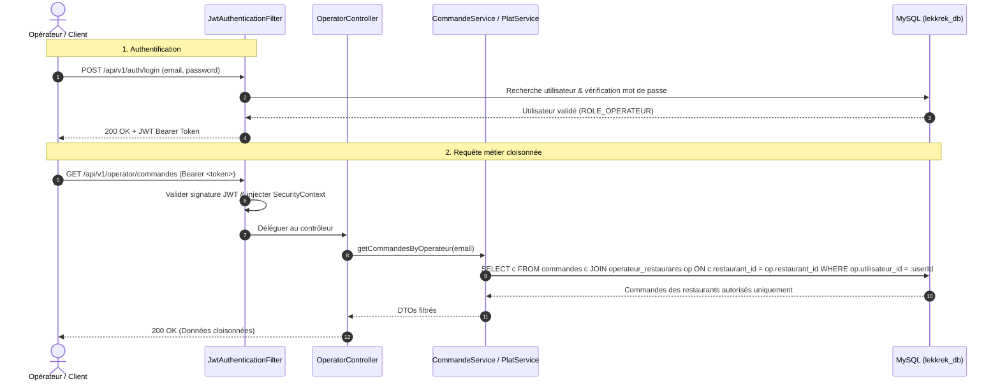
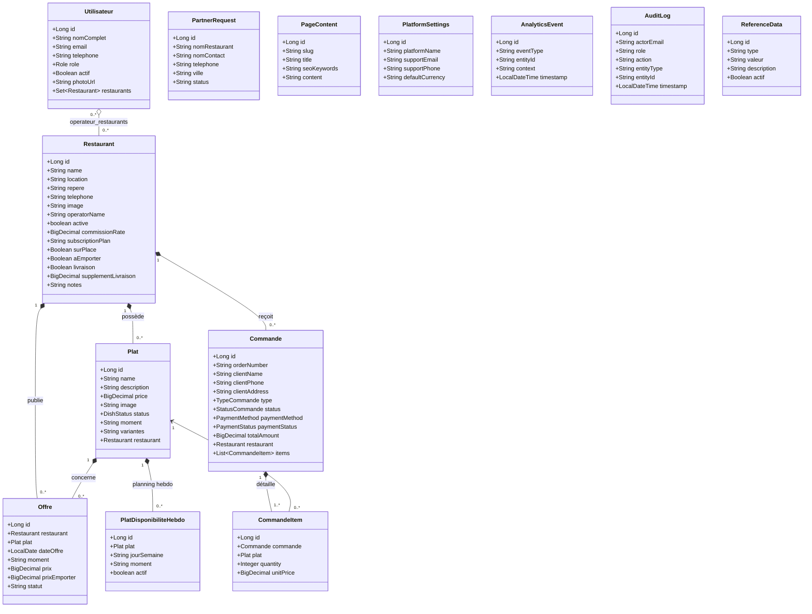

# LekkRek - Backend API ⚙️

Ce répertoire contient l'API RESTful du projet LekkRek, développée avec **Spring Boot 3** et **Java 21**.

## 🛠️ Technologies Clés
- **Core :** Spring Boot (Web, Data JPA)
- **Sécurité :** Spring Security, JWT (JSON Web Tokens)
- **Base de données :** MySQL, Hibernate
- **Outils métiers :** Apache Tika (Extraction PDF/Word pour le CMS)
- **Documentation :** Swagger / SpringDoc OpenAPI

## 📂 Architecture des packages
Le code source se trouve dans \`src/main/java/com/lekkrek/\` :
- \`config/\` : Configuration globale (Web, CORS, Loaders).
- \`controller/\` : Contrôleurs REST (Endpoints publics, admin, opérateurs).
- \`dto/\` : Objets de transfert de données (Data Transfer Objects).
- \`entity/\` : Modèles de la base de données (Entities JPA).
- \`repository/\` : Interfaces d'accès aux données (Spring Data JPA).
- \`security/\` : Filtres JWT, gestion des rôles (Admin / Opérateur).
- \`service/\` : Logique métier (Commandes, KPI, Plats, etc.).
- \`scheduler/\` : Tâches planifiées (ex: cron jobs).

## 🔐 Sécurité & Authentification
L'API est sécurisée via des **Tokens JWT** (HMAC-SHA256). 
- Les routes `/api/v1/public/**` sont ouvertes (catalogue, plats du jour, tracking commande, formulaires de contact).
- Les routes `/api/v1/admin/**` exigent le rôle `ROLE_ADMIN`.
- Les routes `/api/v1/operator/**` exigent les rôles `ROLE_OPERATEUR` ou `ROLE_ADMIN`.

> 🛡️ **Cloisonnement Opérateur (Relation 0..n) :**  
> Les requêtes envoyées à `/api/v1/operator/**` sont strictement filtrées en base de données selon les restaurants assignés à l'opérateur connecté (via la table de liaison `operateur_restaurants`). Un opérateur ne peut ni lire ni modifier les plats, plannings ou commandes d'un restaurant qui ne lui est pas attribué.

### Diagramme de Séquence : Authentification & Contrôle d'Accès

## 📐 Modèle de Données & Diagramme de Classes UML (JPA)

## 📄 Documentation API Interactive (Swagger)
Une fois le backend lancé (`mvn spring-boot:run`), vous pouvez explorer et tester toutes les routes API directement via Swagger UI :
👉 **http://localhost:8080/swagger-ui.html**

## 📊 Modules Spécifiques
- **CMS & Apache Tika :** Le `DocumentParserController` permet de recevoir des fichiers MultipartFile (PDF, DOCX) et d'en extraire le texte HTML enrichi pour pré-remplir l'éditeur de l'administration.
- **Audit Logging :** Toutes les actions sensibles (validation d'une commande, suppression d'un plat) déclenchent le `AuditService` qui trace l'email, le rôle, l'action et la date.
- **Analytics KPI :** Le `AnalyticsController` centralise les événements front-end (clics WhatsApp, recherches) pour générer des tableaux de bord en temps réel.

## 🔑 Comptes de test par défaut (`DataLoader.java`)
> ⚠️ **Sécurité en Production :** `DataLoader.java` est protégé par `@ConditionalOnProperty(app.dataloader.enabled=true)` et est **désactivé par défaut**. Pour activer l'injection de ces comptes de test en développement local, définissez la variable d'environnement `APP_DATALOADER_ENABLED=true`.

| Rôle | Nom / Restaurant | Email | Mot de passe | Périmètre |
|---|---|---|---|---|
| **Administrateur** | Admin Principal | `admin@lekkrek.com` | `password123` | Accès global plateforme |
| **Opérateur** | Awa Ndiaye *(exemple)* | `awa@lekkrek.com` | `password123` | Assignation dynamique 0..n via `operateur_restaurants` |
