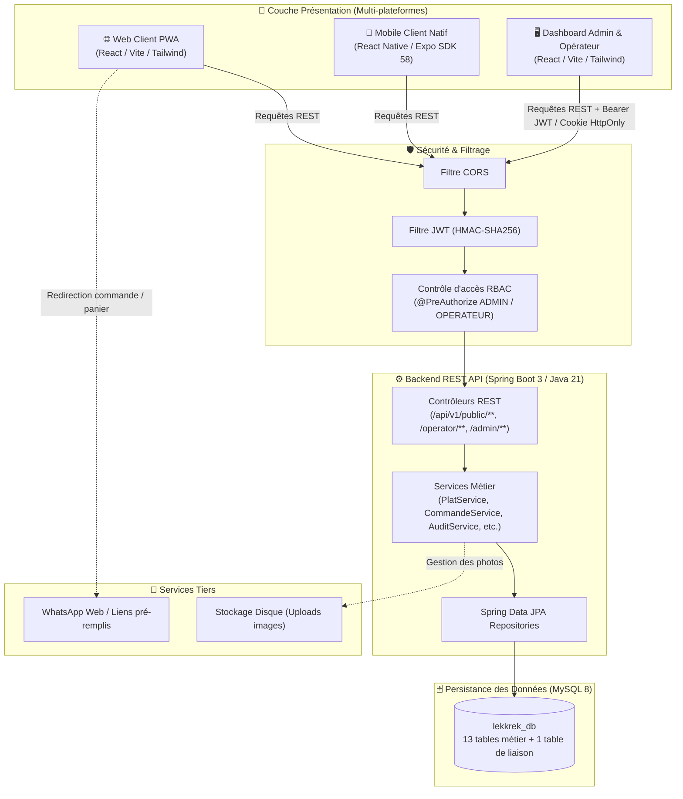
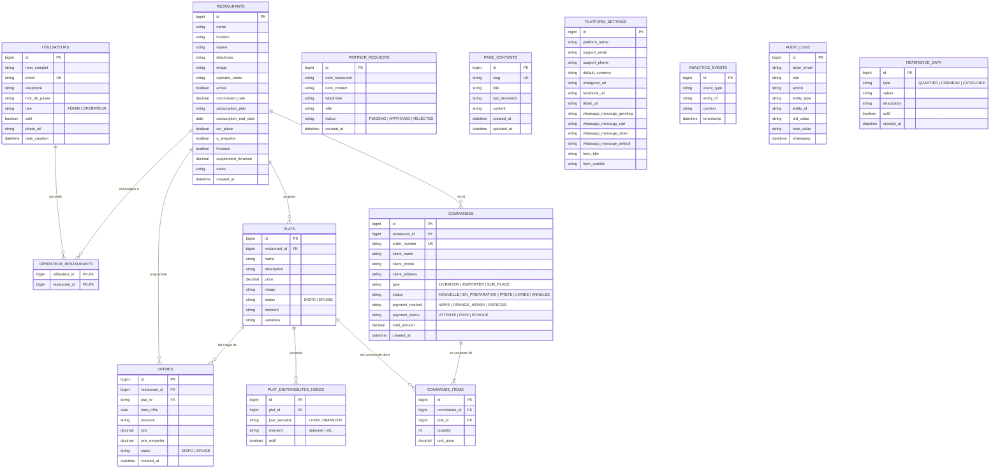

# 📐 Architecture & Diagrammes UML — LekkRek

Ce document regroupe les spécifications architecturales et les diagrammes de modélisation du projet **LekkRek**.

---

## 1. Diagramme d'Architecture Globale (Composants & Flux)

Le diagramme ci-dessous illustre le découpage multi-plateforme, la couche de sécurité Spring Security (JWT / RBAC), les services métier et la persistance MySQL.

---

## 2. Modèle de Données (Diagramme Entité-Relation UML)

Le schéma relationnel comprend 13 entités métier et 1 table de liaison pour la gestion flexible des droits opérateurs (`operateur_restaurants`).

---

[← Retour au README principal](../README.md)
